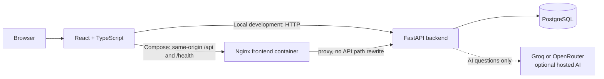

# LogLens

**AI-Powered Application Log Analytics and Intelligent Error Analysis Platform**

LogLens is a local web application for uploading `.log` or `.txt` files, exploring parsed records, reviewing deterministic error analytics, and asking an optional hosted AI assistant questions grounded in selected log evidence.

## What is implemented

- Upload UTF-8 `.log` and `.txt` files, parse the documented timestamp/severity/message format, and retain non-empty unparsed lines with their original line numbers and text.
- Store dataset metadata and entries in PostgreSQL. Uploaded file bytes are not retained separately.
- Browse and search entries with severity filtering, exact line selection, and pagination.
- View per-dataset severity counts, error and warning totals, normalized error patterns, and timestamped activity buckets.
- Ask dataset-scoped questions using Groq or OpenRouter. The backend retrieves bounded evidence and returns answer references. This is keyword-based retrieval, not guaranteed root-cause analysis.
- Run the backend and frontend locally, or run all three services through Docker Compose. GitHub Actions runs backend tests and a frontend production build.

## Architecture



In Docker Compose, Nginx serves the built React application and proxies `/api/` and `/health` to FastAPI. FastAPI connects to PostgreSQL using the Compose service name `db` on port `5432`. In local development, Vite runs on port `5173` and the browser calls FastAPI on port `8000`.

## Technology

- Frontend: React 18, TypeScript, Vite 6
- Backend: Python 3.10+, FastAPI, Pydantic, SQLAlchemy 2, Psycopg 3
- Database: PostgreSQL 16
- Optional hosted LLM providers: Groq and OpenRouter
- Container workflow: Docker Compose, Nginx
- Checks: pytest, frontend Node test runner, TypeScript, Vite production build, GitHub Actions

## Configuration and privacy

Use the repository-root `.env.example` as a template. On a fresh checkout, create `.env` only if it does not already exist:

```bash
if [ ! -f .env ]; then cp .env.example .env; fi
```

Set a private `POSTGRES_PASSWORD` before starting PostgreSQL. Compose obtains `POSTGRES_DB`, `POSTGRES_USER`, and `POSTGRES_PASSWORD` from the root `.env`. For local backend development, PostgreSQL defaults to `127.0.0.1:5433`; inside Compose the backend uses `db:5432`. The host port can be changed with `POSTGRES_HOST_PORT`. The application builds its SQLAlchemy URL from separate settings, so password URL-escaping is not needed.

Other settings include `LOG_LENS_MAX_UPLOAD_BYTES` (defaults to 10 MiB), `LOG_LENS_CORS_ORIGINS`, and `VITE_API_BASE_URL` for local browser development. `VITE_API_BASE_URL` is public frontend configuration, not a place for secrets. Compose uses the same-origin Nginx proxy and does not require it.

For AI questions, set `LLM_PROVIDER=groq` with `GROQ_API_KEY` and `GROQ_MODEL`, or set `LLM_PROVIDER=openrouter` with `OPENROUTER_API_KEY` and `OPENROUTER_MODEL`. The Groq model default is `openai/gpt-oss-20b`; OpenRouter requires a model ID. Provider settings are passed to the backend at runtime and are not built into the frontend image. AI credentials are optional for uploads, browsing, and analytics. Never commit `.env` or expose its values. Sanitize uploaded logs before using a hosted provider because log content may contain secrets or personal data.

If `.env` already exists, preserve its current database credentials. Changing Compose environment values does not change credentials inside an initialized PostgreSQL volume.

## Local development with Git Bash

Run these setup commands from the repository root. Docker Desktop with Compose is needed for PostgreSQL.

```bash
python -m venv backend/.venv
source backend/.venv/Scripts/activate
python -m pip install -r backend/requirements-dev.txt
cd frontend
npm ci
cd ..
docker compose up -d db
docker compose ps
```

Start the backend in one Git Bash terminal from the repository root:

```bash
source backend/.venv/Scripts/activate
python -m uvicorn app.main:app --reload --app-dir backend
```

Start Vite in a second terminal:

```bash
cd frontend
npm run dev
```

Open the frontend at `http://127.0.0.1:5173`. The connection status near the top should report **Backend connected**. The frontend calls `GET /health`; verify it directly with:

```bash
curl http://127.0.0.1:8000/health
```

The response is `{"status":"healthy"}`. If the frontend cannot connect, ensure both servers are running and `VITE_API_BASE_URL` is unset or points to `http://127.0.0.1:8000`. The interactive API documentation is at `http://127.0.0.1:8000/docs`.

To stop the local PostgreSQL service without removing its data, use `docker compose stop db`.

## Run with Docker Compose

This is a separate run mode; do not start the local backend or Vite server at the same time because they use the same host ports. Confirm the root `.env` matches the credentials that initialized the existing database volume. An AI provider key is needed only for AI questions.

Validate the Compose configuration and build/start the three services:

```bash
docker compose config -q
docker compose build
docker compose up --build -d
docker compose ps
```

Open the application at `http://127.0.0.1:5173`. Confirm the frontend is healthy and check its backend connection status. In Compose, the frontend calls same-origin `/health` and `/api/`; Nginx forwards those requests to FastAPI. Direct backend health and API docs are available at `http://127.0.0.1:8000/health` and `http://127.0.0.1:8000/docs`.

Useful service commands:

```bash
docker compose logs -f frontend backend
docker compose logs -f db
docker compose stop
docker compose down
```

The named `loglens_postgres_data` volume stores PostgreSQL data and survives `stop` and `down`. `down` removes containers and the network, but not that named volume. Do not use `docker compose down -v` or volume-pruning commands for routine troubleshooting; those can delete database data. The Compose database service, localhost-only host port mapping (`127.0.0.1:${POSTGRES_HOST_PORT:-5433}:5432`), volume name, and health check are part of the existing configuration.

## API overview

| Method and path | Purpose |
| --- | --- |
| `GET /health` | API process health response |
| `POST /api/uploads` | Upload and parse a multipart `.log` or `.txt` file |
| `GET /api/uploads?limit=20` | List recent uploads (limit 1–100) |
| `GET /api/uploads/{upload_id}/entries` | Page and filter entries by severity, text, or exact line number |
| `GET /api/uploads/{upload_id}/analytics` | Dataset-scoped counts, error patterns, and activity buckets |
| `POST /api/uploads/{upload_id}/ai/chat` | Ask a dataset-scoped question and receive bounded evidence references |

The sample log is `backend/sample_logs/sample.log`. Upload it to a locally running backend with Git Bash:

```bash
curl -F "file=@backend/sample_logs/sample.log" http://127.0.0.1:8000/api/uploads
```

Use the returned upload `id` to request a filtered page:

```bash
curl -G "http://127.0.0.1:8000/api/uploads/UPLOAD_ID/entries" \
  --data-urlencode "severity=ERROR" \
  --data-urlencode "q=timeout" \
  --data-urlencode "page=1" \
  --data-urlencode "page_size=25"
```

The parser skips blank lines but preserves each non-empty line's physical line number. Unrecognized lines remain available as raw, unparsed entries. `WARNING` is normalized to `WARN`. Invalid query parameters return HTTP 422, a missing upload ID returns 404, invalid or unsupported uploads return 400, oversized uploads return 413, and database failures return a generic 503 without SQL details.

## Analytics and AI behavior

Analytics are computed in backend code from the selected dataset. Error-like entries (`ERROR`, `FATAL`, `CRITICAL`) are grouped by severity and simple normalization: case and whitespace differences are collapsed, and timestamps, UUIDs, and valid IPv4 addresses are replaced. Numeric values such as status codes remain distinct. The page shows up to 10 top patterns with occurrence counts and representative source lines; the API includes the unique and recurring pattern counts. Timestamped entries feed activity buckets; unparsed entries are counted separately.

For AI questions, follow-up requests include at most four prior turns. If the dataset fits the evidence entry and context-size limits, all entries are provided to the model. Larger datasets use bounded keyword retrieval (up to 100 candidates and 12 evidence entries, with each message capped at 1,200 characters). The prompt distinguishes complete-dataset evidence from a retrieved subset. Responses include evidence references; when the model does not provide completion metadata, the UI marks completion status as unknown. Treat answers as assistance, check citations against the displayed source entries, and do not treat a suggested explanation as a proven root cause.

Groq and OpenRouter availability, model limits, and account quotas can change. See the [Groq API reference](https://console.groq.com/docs/api-reference) and [OpenRouter model list](https://openrouter.ai/models) for current provider information.

## Tests and continuous integration

From the repository root, with the backend virtual environment active:

```bash
python -m pytest backend/tests -q
```

Run the frontend checks from `frontend`:

```bash
npm test
npm run build
```

Backend tests use an isolated in-memory SQLite database and do not connect to or reset the Compose PostgreSQL volume. AI provider calls are mocked, so tests require no real API key and consume no provider quota. The frontend build runs TypeScript checking before the Vite production build.

`.github/workflows/ci.yml` runs separate backend-test and frontend-build jobs on pushes to `main` and pull requests targeting `main`. The backend job installs `backend/requirements-dev.txt` and runs the backend suite; the frontend job uses `npm ci` with `frontend/package-lock.json`, then runs `npm run build`. The jobs use no `.env`, PostgreSQL service, or live provider credentials. CI is not a cloud deployment workflow. A successful local run does not confirm that GitHub Actions has completed; check the repository Actions page after a push or pull request.

## Current limitations

- Only the documented timestamp + severity + message format is parsed. Other formats and multiline stack-trace grouping are not supported.
- The original uploaded file bytes are not retained. There is no delete or export interface.
- SQLAlchemy `create_all` creates missing tables but does not migrate existing schemas.
- AI is keyword-retrieval question answering. There is no dedicated whole-dataset summary endpoint, semantic search, embeddings, saved chat history, or authentication. Hosted model responses can still be wrong or incomplete.
- Error-pattern grouping is heuristic, not semantic similarity. Only the top 10 patterns are displayed. Activity buckets require timestamps.
- This phase provides local Docker Compose and GitHub Actions checks, but no AWS deployment, CloudWatch monitoring, or automated release pipeline.
