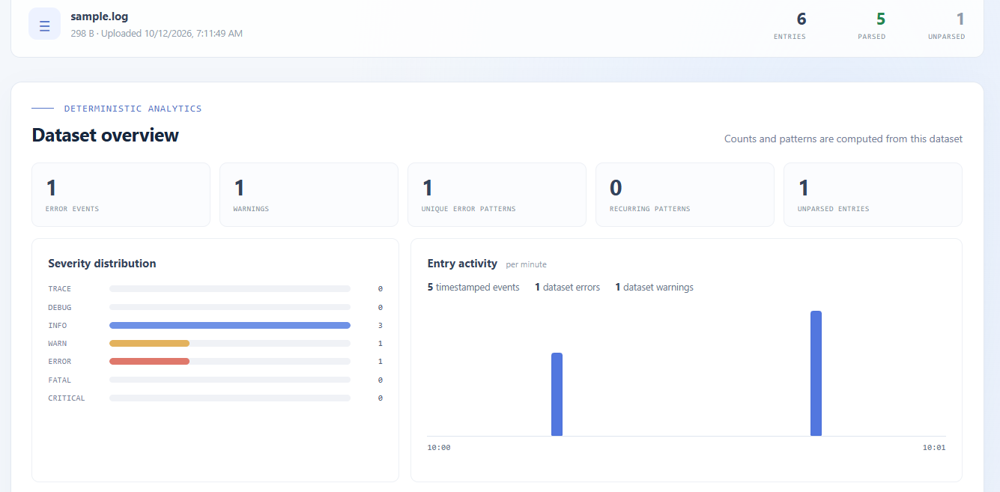
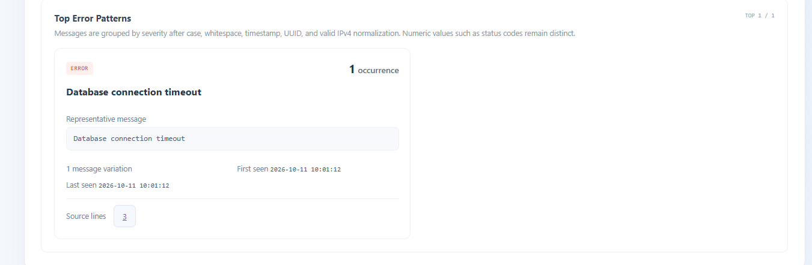
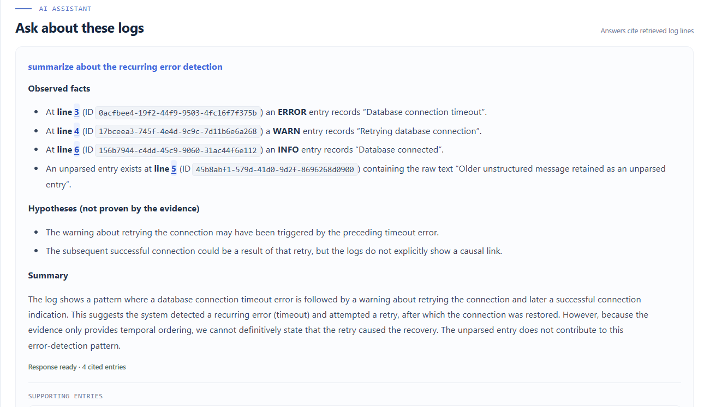
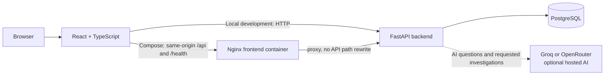

# LogLens

**AI-Powered Application Log Analytics and Intelligent Error Analysis Platform**

LogLens is a local web application for uploading plain-text or structured JSON logs, exploring parsed records, reviewing deterministic error analytics, and asking an optional hosted AI assistant questions grounded in selected log evidence.

## What is implemented

- Upload UTF-8 `.log`, `.txt`, `.json`, `.jsonl`, and `.ndjson` files. Plain-text logs use the documented timestamp/severity/message format; JSON Lines and JSON object/array documents recognize common time, severity, and message aliases. Raw records and physical starting line numbers are retained, including malformed JSON lines as unparsed entries.
- Store dataset metadata and entries in PostgreSQL. Uploaded file bytes are not retained separately.
- Browse and search entries with severity filtering, exact line selection, and pagination.
- View per-dataset severity counts, error and warning totals, normalized error patterns, and timestamped activity buckets. Timeline buckets can filter the underlying explorer records; dashboard navigation links the overview, explorer, analytics, and AI investigator areas.
- Ask dataset-scoped questions using Groq or OpenRouter. The backend retrieves bounded evidence and returns answer references. This is keyword-based retrieval, not guaranteed root-cause analysis.
- Generate a validated troubleshooting workflow for a selected error pattern. The backend checks graph structure and validates every cited log line against the selected dataset; suggested causes remain unconfirmed.
- Optionally upload a bounded source-code ZIP for a dataset. LogLens rejects unsafe archive structures, excludes sensitive/generated paths, redacts common secret patterns, indexes only selected source files, and deletes/replaces indexed context on request. Source snippets are sent to the configured model only when the user explicitly opts in to a source-aware investigation.
- Run the backend and frontend locally, or run all three services through Docker Compose. GitHub Actions runs backend tests and a frontend production build.

## Application Screenshots

### Analytics Dashboard

The dataset overview brings together severity distribution, the activity timeline, and error-pattern analytics for the selected upload.



### Top Error Patterns

Similar error messages are grouped into normalized patterns. Each card shows its occurrence count, message variations, first and last timestamps, and source-line links. The example below has one occurrence, so it is not labeled as recurring.



### Evidence-Grounded AI Assistant

Ask questions about the selected dataset, inspect the cited log entries, and review observed facts separately from hypotheses.



## Architecture



In Docker Compose, Nginx serves the built React application and proxies `/api/` and `/health` to FastAPI. FastAPI connects to PostgreSQL using the Compose service name `db` on port `5432`. In local development, Vite runs on port `5173` and the browser calls FastAPI on port `8000`.

## Technology

- Frontend: React 18, TypeScript, Vite 6
- Backend: Python 3.10+, FastAPI, Pydantic, SQLAlchemy 2, Psycopg 3
- Database: PostgreSQL 16
- Optional hosted LLM providers: Groq and OpenRouter
- Container workflow: Docker Compose, Nginx
- Checks: pytest, frontend Node test runner, TypeScript, Vite production build, GitHub Actions

## Configuration and privacy

Use the repository-root `.env.example` as a template. On a fresh checkout, create `.env` only if it does not already exist:

```bash
if [ ! -f .env ]; then cp .env.example .env; fi
```

Set a private `POSTGRES_PASSWORD` before starting PostgreSQL. Compose obtains `POSTGRES_DB`, `POSTGRES_USER`, and `POSTGRES_PASSWORD` from the root `.env`. For local backend development, PostgreSQL defaults to `127.0.0.1:5433`; inside Compose the backend uses `db:5432`. The host port can be changed with `POSTGRES_HOST_PORT`. The application builds its SQLAlchemy URL from separate settings, so password URL-escaping is not needed.

Other settings include `LOG_LENS_MAX_UPLOAD_BYTES` (defaults to 10 MiB), `LOG_LENS_CORS_ORIGINS`, and `VITE_API_BASE_URL` for local browser development. `VITE_API_BASE_URL` is public frontend configuration, not a place for secrets. Compose uses the same-origin Nginx proxy and does not require it.

For AI questions, set `LLM_PROVIDER=groq` with `GROQ_API_KEY` and `GROQ_MODEL`, or set `LLM_PROVIDER=openrouter` with `OPENROUTER_API_KEY` and `OPENROUTER_MODEL`. The Groq model default is `openai/gpt-oss-20b`; OpenRouter requires a model ID. Provider settings are passed to the backend at runtime and are not built into the frontend image. AI credentials are optional for uploads, browsing, and analytics. Never commit `.env` or expose its values. Sanitize uploaded logs before using a hosted provider because log content may contain secrets or personal data.

If `.env` already exists, preserve its current database credentials. Changing Compose environment values does not change credentials inside an initialized PostgreSQL volume.

## Local development with Git Bash

Run these setup commands from the repository root. Docker Desktop with Compose is needed for PostgreSQL.

```bash
python -m venv backend/.venv
source backend/.venv/Scripts/activate
python -m pip install -r backend/requirements-dev.txt
cd frontend
npm ci
cd ..
docker compose up -d db
docker compose ps
```

Start the backend in one Git Bash terminal from the repository root:

```bash
source backend/.venv/Scripts/activate
python -m uvicorn app.main:app --reload --app-dir backend
```

Start Vite in a second terminal:

```bash
cd frontend
npm run dev
```

Open the frontend at `http://127.0.0.1:5173`. The connection status near the top should report **Backend connected**. The frontend calls `GET /health`; verify it directly with:

```bash
curl http://127.0.0.1:8000/health
```

The response is `{"status":"healthy"}`. If the frontend cannot connect, ensure both servers are running and `VITE_API_BASE_URL` is unset or points to `http://127.0.0.1:8000`. The interactive API documentation is at `http://127.0.0.1:8000/docs`.

To stop the local PostgreSQL service without removing its data, use `docker compose stop db`.

## Run with Docker Compose

This is a separate run mode; do not start the local backend or Vite server at the same time because they use the same host ports. Confirm the root `.env` matches the credentials that initialized the existing database volume. An AI provider key is needed only for AI questions.

Validate the Compose configuration and build/start the three services:

```bash
docker compose config -q
docker compose build
docker compose up --build -d
docker compose ps
```

Open the application at `http://127.0.0.1:5173`. Confirm the frontend is healthy and check its backend connection status. In Compose, the frontend calls same-origin `/health` and `/api/`; Nginx forwards those requests to FastAPI. Direct backend health and API docs are available at `http://127.0.0.1:8000/health` and `http://127.0.0.1:8000/docs`.

Useful service commands:

```bash
docker compose logs -f frontend backend
docker compose logs -f db
docker compose stop
docker compose down
```

The named `loglens_postgres_data` volume stores PostgreSQL data and survives `stop` and `down`. `down` removes containers and the network, but not that named volume. Do not use `docker compose down -v` or volume-pruning commands for routine troubleshooting; those can delete database data. The Compose database service, localhost-only host port mapping (`127.0.0.1:${POSTGRES_HOST_PORT:-5433}:5432`), volume name, and health check are part of the existing configuration.

## API overview

| Method and path | Purpose |
| --- | --- |
| `GET /health` | API process health response |
| `POST /api/uploads` | Upload and parse a multipart `.log`, `.txt`, `.json`, `.jsonl`, or `.ndjson` file |
| `GET /api/uploads?limit=20` | List recent uploads (limit 1–100) |
| `GET /api/uploads/{upload_id}/entries` | Page and filter entries by severity, text, exact line, or inclusive `timestamp_from` / exclusive `timestamp_to` |
| `GET /api/uploads/{upload_id}/analytics` | Dataset-scoped counts, error patterns, and activity buckets |
| `POST /api/uploads/{upload_id}/ai/chat` | Ask a dataset-scoped question and receive bounded evidence references |
| `POST /api/uploads/{upload_id}/ai/investigations` | Generate a bounded workflow for a dataset-local error pattern; request body includes `pattern_fingerprint` and optional `include_source_context` |
| `GET`, `PUT`, `DELETE /api/uploads/{upload_id}/source-context` | Check, replace, or remove a dataset's indexed source context (PUT multipart field `file`, ZIP only) |

The sample log is `backend/sample_logs/sample.log`. Upload it to a locally running backend with Git Bash:

```bash
curl -F "file=@backend/sample_logs/sample.log" http://127.0.0.1:8000/api/uploads
```

Use the returned upload `id` to request a filtered page:

```bash
curl -G "http://127.0.0.1:8000/api/uploads/UPLOAD_ID/entries" \
  --data-urlencode "severity=ERROR" \
  --data-urlencode "q=timeout" \
  --data-urlencode "page=1" \
  --data-urlencode "page_size=25"
```

The parser skips blank lines but preserves each non-empty line's physical line number. Structured JSON uploads are capped at 50,000 records. Plain-text unrecognized lines and malformed JSONL records remain available as raw, unparsed entries. Multiline JSON arrays preserve each object's starting physical line; if multiple array records start on the same physical line (for example, a compact one-line array), the entire physical line is retained as one unparsed entry because the current log-entry schema requires unique line numbers per dataset. Malformed `.json` documents also fall back to per-line preservation. `WARNING` is normalized to `WARN`. JSON records without recognized timestamp/severity values keep those fields empty; the full raw record remains stored. Invalid query parameters return HTTP 422, a missing upload ID returns 404, invalid or unsupported uploads return 400, oversized uploads return 413, and database failures return a generic 503 without SQL details.

## Analytics and AI behavior

Analytics are computed in backend code from the selected dataset. Error-like entries (`ERROR`, `FATAL`, `CRITICAL`) are grouped by severity and deterministic normalization: case and whitespace differences are collapsed, and recognizable timestamps, UUIDs, valid IPv4/IPv6 addresses, and long values after explicit request/correlation/trace ID labels are replaced in the grouping template. Meaningful numbers such as HTTP status codes remain distinct. The page shows up to 10 top patterns with occurrence counts and representative source lines; the API includes the unique and recurring pattern counts. Timestamped entries feed activity buckets with per-severity counts; selecting a timeline bucket applies the same time window to the actual explorer API query. Unparsed entries are counted separately. This is normalized-pattern grouping, not semantic understanding or proof of a common root cause. Embedding-based grouping is only being evaluated; it is not implemented.

For AI questions, follow-up requests include at most four prior turns. If the dataset fits the evidence entry and context-size limits, all entries are provided to the model. Larger datasets use bounded keyword retrieval (up to 100 candidates and 12 evidence entries, with each message capped at 1,200 characters). The prompt distinguishes complete-dataset evidence from a retrieved subset. Responses include evidence references; when the model does not provide completion metadata, the UI marks completion status as unknown. Troubleshooting workflows are requested for one selected pattern, use up to 12 nearby dataset-local records, and allow at most 12 nodes, 16 acyclic edges, and five diagnostic branches. Provider output is schema-checked before display; references that do not resolve to real evidence are rejected. Workflows do not execute actions.

### Optional source context

Upload a ZIP from the selected dataset's AI Assistant section. The archive is limited to 5 MiB compressed, 15 MiB eligible extracted source, 5,000 archive entries, 200 eligible source files, 256 KiB per source file, and 3,000 indexed chunks. Only an explicit source-code extension allowlist is indexed; dependency directories, build output, lockfiles, environment files, and key/certificate extensions are excluded. Absolute/traversal paths, symbolic links, encrypted entries, duplicate source paths, high compression ratios, and over-limit files are rejected. Common key/token assignments and token forms are redacted before storage. This is pattern-based redaction, not a guarantee that every secret is detected.

The ZIP bytes are not retained. Redacted indexed chunks are stored in the additive `source_context_chunks` PostgreSQL table, scoped by dataset, until replaced with another ZIP or explicitly deleted. The application creates the new table with SQLAlchemy `create_all` on startup; this does not alter existing upload or log-entry tables. Source snippets are not sent to an LLM during ordinary chat or log-only investigations. In the interface, the source-context checkbox applies to **Investigate this error** (`POST /api/uploads/{upload_id}/ai/investigations`); it does not apply to **Ask LogLens** (`POST /api/uploads/{upload_id}/ai/chat`). The user must upload source code they are authorized to share and enable the source-context option for an investigation. Returned source references identify indexed paths/chunks and distinguish code observations from runtime facts.

Groq and OpenRouter availability, model limits, and account quotas can change. See the [Groq API reference](https://console.groq.com/docs/api-reference) and [OpenRouter model list](https://openrouter.ai/models) for current provider information.

## Tests and continuous integration

From the repository root, with the backend virtual environment active:

```bash
python -m pytest backend/tests -q
```

Run the frontend checks from `frontend`:

```bash
npm test
npm run build
```

Backend tests use an isolated in-memory SQLite database and do not connect to or reset the Compose PostgreSQL volume. AI provider calls are mocked, so tests require no real API key and consume no provider quota. The frontend build runs TypeScript checking before the Vite production build.

### Latest local verification

Verified locally on 2026-10-15: the complete backend suite passed (104 tests, with one Starlette deprecation warning); all frontend tests passed (9 tests); and TypeScript checking plus the Vite production build passed. The build output was directed to a temporary directory because the existing `frontend/dist` output could not be cleared in the verification environment. `docker compose config -q` and `git diff --check` passed. The Docker CLI was present, but access to the Docker Engine was denied, so image builds, container health checks, and the live `/health` endpoint could not be verified here. No GitHub Actions run was observed, so remote CI status remains unverified.

`.github/workflows/ci.yml` runs separate backend-test and frontend-build jobs on pushes to `main` and pull requests targeting `main`. The backend job installs `backend/requirements-dev.txt` and runs the backend suite; the frontend job uses `npm ci` with `frontend/package-lock.json`, then runs `npm run build`. The jobs use no `.env`, PostgreSQL service, or live provider credentials. CI is not a cloud deployment workflow. A successful local run does not confirm that GitHub Actions has completed; check the repository Actions page after a push or pull request.

## Current limitations

- JSON timestamp values currently support ISO-formatted strings. JSON records do not extract service/component metadata into dedicated fields; the original record remains available in `raw_line`.
- The original uploaded file bytes are not retained. There is no delete or export interface.
- SQLAlchemy `create_all` creates missing tables but does not migrate existing schemas.
- AI uses keyword retrieval and validated model-generated workflows. There is no semantic search, embeddings, saved chat history, or authentication. Hosted model responses can still be wrong or incomplete; provider output without completion metadata is reported with unknown status.
- Source-code retrieval uses keyword overlap rather than symbol-aware parsing or embeddings. Secret redaction is heuristic; review uploaded code and remove secrets before sharing. Source context is optional and is stored in the same PostgreSQL database until explicitly deleted or replaced.
- Error-pattern grouping is deterministic normalization, not semantic similarity. The evaluated synthetic corpus is for regression testing only and does not measure production accuracy. Embedding-based grouping is not implemented, and a shared pattern does not determine a root cause. Only the top 10 patterns are displayed. Activity buckets require timestamps.
- This phase provides local Docker Compose and GitHub Actions checks, but no AWS deployment, CloudWatch monitoring, or automated release pipeline.
